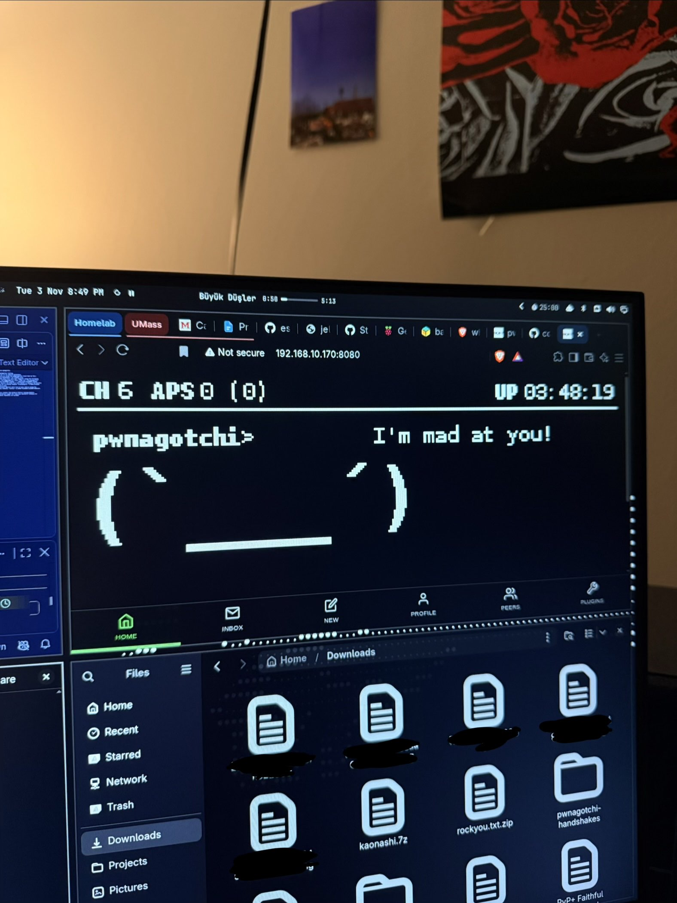
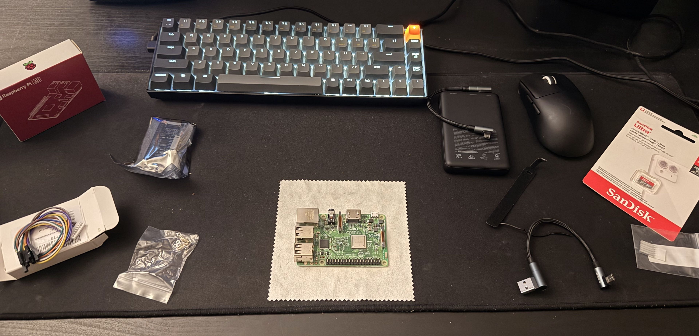

# Pwnagotchi-build

This is a Raspberry Pi based Pwnagotchi: a Raspberry Pi using bettercap to passively listen for WPA/WPA2 handshakes. It is important to mention that the pwnagotchi also has feelings! It will get bored or even angry at you when you do not feed it WPA/WPA2 handshakes and it will be amused when you do. It is inspired by the tamagotchi handheld digital pet. I built this project to learn WiFi security hands-on. I also wrote a script in python to automate the hashcat testing process against multiple wordlists. 

## What it does
The Pwnagotchi uses bettercap to passively listen for WPA/WPA2 handshakes. Once handshakes are discovered, it stores these handshakes as .pcapng files. You can then use these .pcapng files with hashcat to crack wifi passwords. THE PWNAGOTCHI CAN ONLY BE TESTED ON NETWORKS YOU OWN OR HAVE WRITTEN PERMISSION TO TEST ON. DO NOT TEST ON OTHER NETWORKS AS IT IS ILLEGAL. 

## Hardware
 
- Board: While this project is normally done with a Raspberry Pi Zero 2 WH as a compact, mobile design, I could not find the board in stock so I chose to use the Raspberry Pi 3 Model B. This project can be done on any Raspberry Pi. 
- Display: The Waveshare 2.13" e-ink V4 is the typical screen for this project. Beware this screen can come dead sometimes, mine came dead and I had to replace it but then it worked.
- Power: I used the INIU 10000 mAh power bank. I chose this over a UPS HAT because it was cheaper and I didn't want to buy separate batteries. Choose the UPS HAT if you prefer a nicer software shutdown.
- Storage: 32 GB microSD card is perfect for this.
- Cables: If you choose the INIU 10000 mAh power bank, a short USB A to right angle Micro USB cable is helpful. You may refer to the images of my final build below. 

## Software:
- Image: Pwnagotchi image is from https://github.com/jayofelony/pwnagotchi
- Flashed with: I used balenaEtcher to flash but Raspberry Pi imager works as well.

## Build steps:
1. Flash the pwnagotchi image to the microSD card. Make sure you have a device or an adapter that has a microSD card port. Install the image to your device then use a flasher such as balenaEtcher to flash the image onto the microSD card. Once done you may put the microSD into the microSD slot on the Pi. Every Pi is different but on the Pi 3B it was on the bottom side of the Pi. 
2. Attach the e-ink display to the GPIO header on the Pi. There should be 40 pins in two rows on the Pi. Make sure you seat the screen properly with all pins connected firmly to the screen.
3. Then power the Pi using the micro USB slot. Wait for it to boot as it will restart once or twice. Once booted, ssh into the pi using "ssh pi@pwnagotchi.local" to see if it is running properly. The default password for the Pi is "raspberry".
4. Once in check the config.toml file. cd / then cat /etc/pi/pwnagotchi/config.toml. The config file should match the config file in this repo at the bare minimum. You may edit this file later on if you need to.
5. At this point everything should be working properly. Enjoy your pwnagotchi!

# How to use the pwnagotchi:

! THE PWNAGOTCHI IS MEANT TO BE TESTED AGAINST NETWORKS YOU OWN OR HAVE WRITTEN PERMISSION TO TEST. DO NOT TEST ON OTHER NETWORKS AS IT IS ILLEGAL. 

## Prerequisites: 
1. This guide is assuming your device is on Linux. You may need to find variations for commands for your device. 
2. On your device, in the Projects folder, you should create a folder called pwnagotchi. In the pwnagotchi folder you should create the folders pcapfiles and wordlists. In the wordlists folder you should create another folder called rules. All installed wordlists should go in the wordlists folder and rules in the rules folder. 
2. You must install the wordlists and rules before. Install the word list rock you and the rules best64 and OneRuleToRuleThemAllStill. Also install kaonashi. These are required for the script to work but you may use any wordlist you choose. 
3. You must also install hashcat.

## Steps:

1. Make sure pwnagotchi is on and running. To check, SSH in and "sudo systemctl status pwnagotchi". It should say Active(running).
2. Wait for it to capture handshakes. Make sure you are not only near the router but near the devices connected to that router as well. 
3. Once handshakes are captured, SSH into the Pi using SSH pi@pwnagotchi.local and cd /etc/pwnagotchi/handshakes/ then ls to see the pcapng files.
4. Put the pcapng files onto your computer using the following command: ssh pi@pwnagotchi.local "sudo cat '/etc/pwnagotchi/handshakes/YOURCAPTURE.pcapng'" > ~/Projects/pwnagotchi/pcapfiles/YOURCAPTURE.pcapng

## THEN (auto)
5. Run the script crackpcap.py with a .pcapng file. Make sure you are in /Projects/pwnagotchi and run python3 crackpcap.py pcapfiles/FILENAME.pcapng
6. Wait for results as it tests through stages (smaller to larger wordlists.)

## OR (manual)
5. Then convert the pcapng file into hashes so hashcat can process it using the following command: hcxpcapngtool -o NAME.hc22000 YOURCAPTURE.pcapng
6. Run hashcat against word list of your choice using the following commandL: hashcat -m 22000 FILENAME.hc22000 WORDLIST.txt

## Problems I hit (and how I fixed them):
- I wanted to do this project with the Pi Zero 2 WH but could not find it in stock anywhere for a long time so had to rebuild the plan around the Pi 3 Model B.
- The Waveshare screen that I initially ordered did not work at first. I made sure the config file was correct, the screen was attached correctly, the FPC cable was attached correctly, and ran tests on the screen such as the demo from waveshare themselves. Unfortunately, the screen did not end up working at all so I had to replace the screen for it to then work.

## What I learned:
- How the WPA/WPA 2 4-way handshake works and why capturing it matters.
- Monitor mode on devices and how WiFi deauthentication works.
- Linux/SSH basics on a headless Raspberry Pi. 

